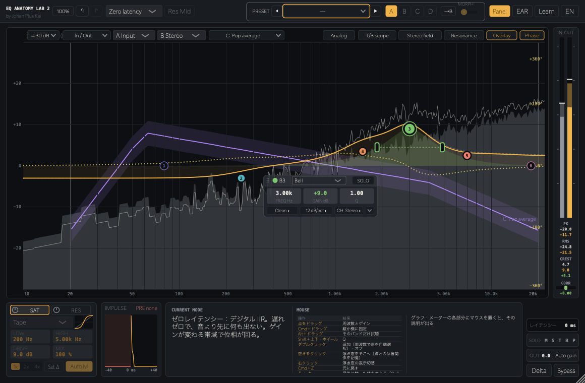
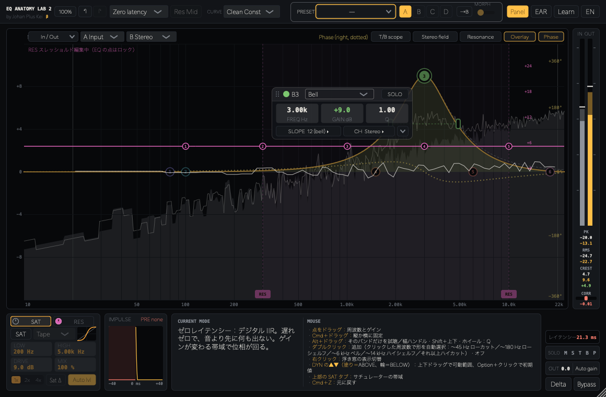
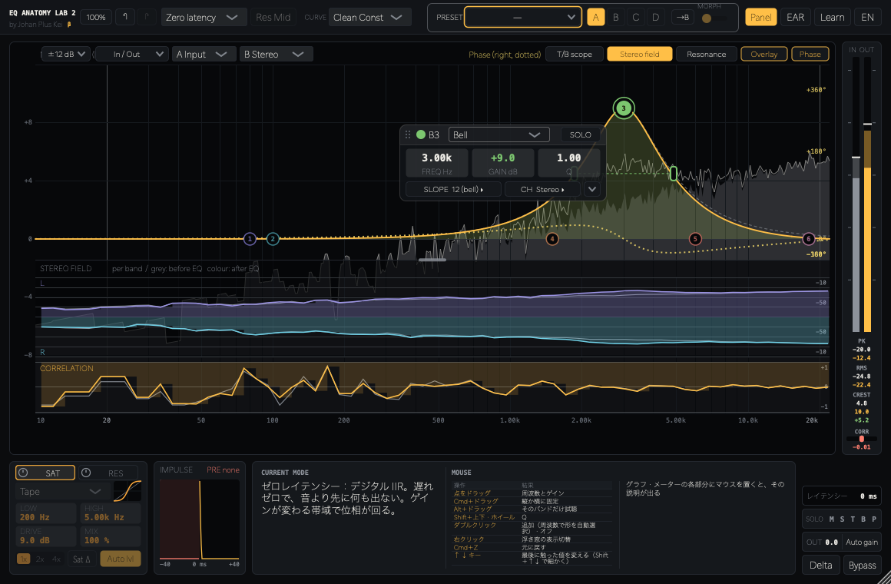

# EQ Anatomy Lab 2 β（JUCE プラグイン）

by Johan Plus Kei — EQ の中身を「見て・聴いて・触って」学べる VST・AU 対応プラグイン（VST3 / AU / Standalone）。[EQ Anatomy Lab](https://github.com/kazufumi01/EQAnatomyLab) の後継ベータ版（別製品）



## ⬇️ ダウンロード（ベータ版）/ Download (Beta)

**[最新版をダウンロード / Download latest](https://github.com/kazufumi01/EQAnatomyLab2/releases/latest)** — 無料配布中 / Free

| | 手動インストール（おすすめ） | インストーラー |
|---|---|---|
| **Mac**（macOS 11+, Apple Silicon / Intel） | `EQAnatomyLab2-0.2.0-mac.zip` | `EQAnatomyLab2-0.2.0-mac.pkg` |
| **Windows**（10 / 11, 64bit）⚠️未検証 | `EQAnatomyLab2-0.2.0-win64.zip` | `EQAnatomyLab2-0.2.0-win64.exe` |

- 紹介記事（日本語）：**[このEQを触ると、自分に必要なEQが分かる](https://jpk.seesaa.net/article/521995892.html)**
- インストール方法：**[INSTALL.md](INSTALL.md)**（日本語 / English）
- ⚠️ **Windows 版は実機での動作確認ができていません**（自動ビルドで作成。VST3 と Standalone）。 / The Windows build of Lab 2 is untested on real hardware.
- Apple の公証・Windows のコード署名をしていないため、初回のみ警告が出ます。
- 既存の EQ Anatomy Lab とは別製品なので、両方を同時にインストールできます。
- 不具合・要望は [Issues](https://github.com/kazufumi01/EQAnatomyLab2/issues) へ。

---

## 主な機能

- **6 バンド EQ**：Bell / Shelf / Cut など。動作モードは Zero latency／Analog／Linear（リニアフェイズ）。位相はバンドごとに Min / Lin を選択
- **ベルの傾き**：12 / 24 / 48 dB。24・48 はバンドシェルフ（中心が設定ゲインになるよう補正）
- **ダイナミック EQ**、**Mid/Side 処理**（St / M / S と SOLO）、**Transient / Body 分離**
- **レゾナンス・サプレッサー**（RES）：耳障りな共鳴だけを自動で抑える。Stereo / Mid / Side / M/S、サイドチェイン検出、5 ノードのスレッショルド曲線を EQ グラフ上で編集
- **周波数特性・位相・群遅延**の重ね描き／上下分割表示、インパルス応答でプリリンギングを確認
- **Stereo field** 表示（帯域ごとの L/R の音量と相関、10 Hz から）、10 Hz〜22 kHz の周波数軸、スペアナ A/B
- **画面の各部分に説明**：グラフの点・ハンドル・下の枠・軸・スペアナ、メーターの PK / RMS / CREST / CORR にマウスを置くと、表付きの解説が説明欄に出る
- **キーボード**：↑↓ で最後に触った値（Shift で細かく）。グラフの点と RES の点は ↑↓＝dB、←→＝周波数
- **配色**：14 種類（明度を抑えた Soft 系 4 種を含む）
- **サチュレーター**（帯域指定・オーバーサンプリング）、Auto gain、Delta（差分）試聴
- **A / B / C / D スロット**とモーフ、**ユーザープリセット**（名前とメモ付きで保存）
- **Ear Training（耳トレ）**と **Learn（レッスン）**：RES の使い方を含む。練習音は Drums / Voice
- 日本語 / English 切り替え





---

## ビルド

```bash
./build.sh            # 手元の JUCE を使う（build.sh 内の JUCE_PATH を編集）
```

- Windows は GitHub Actions（`.github/workflows/build-win.yml`、手動実行）で VST3 / Standalone をビルドし、Inno Setup でインストーラーを作成
- Mac のインストーラー作成：`packaging/mac/build_pkg.sh [version]` ／ `packaging/mac/build_zip.sh [version]`（出力は `dist/`）

## ライセンス

JUCE は **Starter ライセンス** で使用。配布物はフリーウェア使用許諾（`packaging/mac/resources/license.txt`）に従います。
ソースは学習目的で公開していますが、無断での再配布・販売はできません。

---

**Johan Plus Kei** — [Spotify](https://open.spotify.com/artist/30PV2gqUbDDwvuWtKaok0x) ・ [Apple Music](https://music.apple.com/us/artist/johan-plus-kei/519360150) ・ [X](https://x.com/johanpluskei) ・ [Instagram](https://www.instagram.com/johanpluskei) ・ [Learning labs](https://kazufumi01.github.io/)

## Support / 支援

EQ Anatomy Lab 2 is free. If it helps your mixing or your classes, you can support development with a one-time tip via [PayPal](https://paypal.me/johanpluskei). More ways to help: <https://kazufumi01.github.io/support/>

EQ Anatomy Lab 2 は無料です。ミックスや授業で役立ったら、[PayPal](https://paypal.me/johanpluskei) からの投げ銭で開発を支えていただけるとうれしいです。
