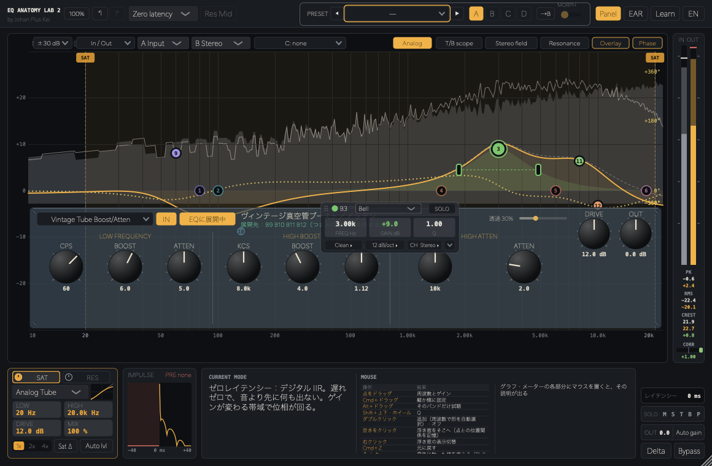

# EQ Anatomy Lab 2

**by Johan Plus Kei** · VST3 / AU / Standalone · 無料 / Free

🇯🇵 EQ の中身を「見て・聴いて・触って」学べるプラグイン。アナログEQ 9 機種を普通のEQバンドに分解して、その正体を確かめられます。
🇬🇧 A plug-in for learning what an EQ really does — by seeing, hearing and touching it. Nine analog EQ models can be laid out as ordinary EQ bands, so you can see what they are made of.

**[日本語](#日本語) · [English](#english) · [ダウンロード / Download](#ダウンロード--download) · [開発者向け / For developers](#開発者向け--for-developers)**


## ダウンロード / Download

**[最新版をダウンロード / Download latest (1.0.0)](https://github.com/kazufumi01/EQAnatomyLab2/releases/latest)**

| | 手動インストール（おすすめ）<br>Manual (recommended) | インストーラー<br>Installer |
|---|---|---|
| **Mac**<br>macOS 11+, Apple Silicon / Intel | `EQAnatomyLab2v1-1.0.0-mac.zip` | `EQAnatomyLab2v1-1.0.0-mac.pkg` |
| **Windows** ⚠️ 未検証 / untested<br>10 / 11, 64-bit | `EQAnatomyLab2v1-1.0.0-win64.zip` | `EQAnatomyLab2v1-1.0.0-win64.exe` |

| | 日本語 | English |
|---|---|---|
| インストール方法 / How to install | [INSTALL.md（日本語）](INSTALL.md#日本語) | [INSTALL.md (English)](INSTALL.md#english) |
| 紹介記事 / Article | [このEQを触ると、自分に必要なEQが分かる](https://jpk.seesaa.net/article/521995892.html) | — |
| DAW 上の名前 / Name in your DAW | **EQ Anatomy Lab 2 v1** | **EQ Anatomy Lab 2 v1** |
| 不具合・要望 / Bugs & requests | [Issues](https://github.com/kazufumi01/EQAnatomyLab2/issues) | [Issues](https://github.com/kazufumi01/EQAnatomyLab2/issues) |

> **ご注意 / Notes**
> - β 版（EQ Anatomy Lab 2）や [EQ Anatomy Lab](https://github.com/kazufumi01/EQAnatomyLab) とは別製品なので、すべて同時にインストールできます。β 版は [過去のリリース](https://github.com/kazufumi01/EQAnatomyLab2/releases) から。<br>It installs side by side with the beta and with EQ Anatomy Lab. Older betas are on the [Releases](https://github.com/kazufumi01/EQAnatomyLab2/releases) page.
> - ⚠️ Windows 版は自動ビルドのみで、実機での動作確認はできていません（VST3 / Standalone）。<br>The Windows build (VST3 / Standalone) is built automatically and has not been tested on real hardware.
> - Apple の公証・Windows のコード署名をしていないため、初回のみ警告が出ます（回避手順は INSTALL.md）。<br>The builds are not notarized or code-signed, so you will see a one-time warning (see INSTALL.md).

---

## 日本語

### 1.0 の新機能

- **アナログEQモデル 9 種**：真空管パッシブ・マスター、精密マスタリング、固定バンドのエアリフト、英国ステップ式バスEQ、60年代スタジオ7バンド、ヴィンテージ真空管ブースト／アッテン、70年代英国インダクター、80年代英国大型卓、米国ディスクリート。実機のパネルを参考にした操作パネルと、モデルごとの回路の歪み付き（どれも学習用の汎用モデルで、特定の製品の再現ではありません）
- **EQに展開**：アナログモデルを、普通のベル・シェルフ・カットのバンドに分解してメインEQに並べる。展開後もパネルのつまみでバンドを動かせるので、「アナログEQは普通のEQのどんな組み合わせか」がグラフの点で見える
- **バンドは 24 まで**（B9〜B24 は使うときだけ表示）
- **サチュレーターに Analog Tube / Trans / Class A**：アナログモデルと同じ回路・同じ DRIVE の目盛り
- **カーブの性格をバンドごとに**（浮き窓の CURVE、11 種）
- **参照カーブ C**：音声ファイルをグラフにドロップすると平均的な周波数バランスを解析して表示（無音や小さすぎる部分は除外）。研究ベースの平均・ジャンル・年代などの内蔵カーブ付き
- **プリセット**：用途別とアナログタイプ別のメニュー、◀ ▶ で順送り、ユーザープリセットとカーブはフォルダで整理（Finder での整理もそのまま反映）
- 配色に **Studio Lift**（EQ 以外を少し明るくした Studio）を追加し、全 15 種



### 主な機能

- **EQ**：Bell / Shelf / Cut など。動作モードは Zero latency／Analog／Linear（リニアフェイズ）。位相はバンドごとに Min / Lin を選択
- **ベルの傾き**：12 / 24 / 48 dB。24・48 はバンドシェルフ（中心が設定ゲインになるよう補正）
- **ダイナミック EQ**、**Mid/Side 処理**（St / M / S と SOLO）、**Transient / Body 分離**
- **レゾナンス・サプレッサー**（RES）：耳障りな共鳴だけを自動で抑える。Stereo / Mid / Side / M/S、サイドチェイン検出、5 ノードのスレッショルド曲線を EQ グラフ上で編集
- **周波数特性・位相・群遅延**の重ね描き／上下分割表示、インパルス応答でプリリンギングを確認
- **Stereo field** 表示（帯域ごとの L/R の音量と相関、10 Hz から）、10 Hz〜22 kHz の周波数軸、スペアナ A/B
- **画面の各部分に説明**：グラフの点・ハンドル・下の枠・軸・スペアナ、メーターの PK / RMS / CREST / CORR にマウスを置くと、表付きの解説が説明欄に出る
- **キーボード**：↑↓ で最後に触った値（Shift で細かく）。グラフの点と RES の点は ↑↓＝dB、←→＝周波数
- **サチュレーター**（帯域指定・オーバーサンプリング）、Auto gain、Delta（差分）試聴
- **A / B / C / D スロット**とモーフ、**ユーザープリセット**（名前とメモ付きで保存）
- **Ear Training（耳トレ）**と **Learn（レッスン）**。練習音は Drums / Voice
- 日本語 / English 切り替え


---

## English

### What's new in 1.0

- **Nine analog EQ models**: tube passive mastering EQ, precision mastering EQ, fixed-band "air lift", British stepped bus EQ, '60s studio 7-band, vintage tube boost/atten, '70s British inductor EQ, '80s British large-format console and American discrete. Each has a panel inspired by the hardware and its own circuit distortion (generic educational models, not reproductions of specific products).
- **Expand to EQ**: break an analog model down into ordinary bell / shelf / cut bands in the main EQ. The panel knobs still drive those bands afterwards, so you can see on the graph which combination of plain EQ bands an analog EQ really is.
- **Up to 24 bands** (B9–B24 appear only when used).
- **Analog Tube / Trans / Class A in the saturator**, using the same circuits and DRIVE scale as the analog models.
- **Per-band curve character** (CURVE in the floating window, 11 types).
- **Reference curve C**: drop an audio file on the graph to see its average spectral balance (silent and very quiet parts are ignored). Built-in curves include research-based averages, genres and decades.
- **Presets**: menus by use and by analog type, ◀ ▶ stepping, and user presets / curves organized in folders (changes made in Finder are picked up).
- **Studio Lift** skin (Studio with everything but the EQ slightly brighter), 15 skins in total.


### Features

- **EQ**: bell, shelf, cut and more. Processing modes: Zero latency / Analog / Linear phase, with Min / Lin phase per band.
- **Bell slopes** of 12 / 24 / 48 dB; 24 and 48 are band-shelves, corrected so the centre sits at the set gain.
- **Dynamic EQ**, **Mid/Side** (St / M / S with SOLO) and **Transient / Body** split.
- **Resonance suppressor (RES)**: tames only harsh resonances. Stereo / Mid / Side / M/S, sidechain detection, and a 5-node threshold curve edited right on the EQ graph.
- **Magnitude, phase and group delay** overlaid or split, plus an impulse response to see pre-ringing.
- **Stereo field** view (level and correlation per band, from 10 Hz), a 10 Hz–22 kHz frequency axis and A/B spectrum analyzer.
- **Help for every part of the screen**: hover over graph points, handles, panels, axes, the analyzer or the PK / RMS / CREST / CORR meters to get an explanation with tables.
- **Keyboard**: ↑↓ changes the last value you touched (Shift for fine steps). On graph and RES points, ↑↓ = dB and ←→ = frequency.
- **Saturator** (band-limited, oversampled), Auto gain and Delta listening.
- **A / B / C / D slots** with morphing, and **user presets** with a name and notes.
- **Ear Training** and **Learn** (lessons), with Drums / Voice practice material.
- Japanese / English UI.


---

## 開発者向け / For developers

```bash
./build.sh   # 手元の JUCE を使う（build.sh 内の JUCE_PATH を編集） / uses your local JUCE (edit JUCE_PATH in build.sh)
```

- Windows：GitHub Actions（`.github/workflows/build-win.yml`、手動実行）で VST3 / Standalone をビルドし、Inno Setup でインストーラーを作成。<br>Windows: built by GitHub Actions (`.github/workflows/build-win.yml`, run manually); the installer is made with Inno Setup.
- Mac：`packaging/mac/build_pkg.sh [version]` ／ `packaging/mac/build_zip.sh [version]`（出力は `dist/` / output in `dist/`）

### ライセンス / License

- JUCE は **Starter ライセンス** で使用。配布物はフリーウェア使用許諾（`packaging/mac/resources/license.txt`）に従います。ソースは学習目的で公開していますが、無断での再配布・販売はできません。
- JUCE is used under the **Starter licence**. The binaries are freeware under `packaging/mac/resources/license.txt`. The source is public for learning; redistribution or sale without permission is not allowed.

---

**Johan Plus Kei** — [Spotify](https://open.spotify.com/artist/30PV2gqUbDDwvuWtKaok0x) ・ [Apple Music](https://music.apple.com/us/artist/johan-plus-kei/519360150) ・ [X](https://x.com/johanpluskei) ・ [Instagram](https://www.instagram.com/johanpluskei) ・ [Learning labs](https://kazufumi01.github.io/)

## Support / 支援

EQ Anatomy Lab 2 is free. A one-time tip via [PayPal](https://paypal.me/johanpluskei) is always welcome — **but what helps even more is sharing it and playing my music on [Spotify](https://open.spotify.com/artist/30PV2gqUbDDwvuWtKaok0x)!** Please do! More ways to help: <https://kazufumi01.github.io/support/>

EQ Anatomy Lab 2 は無料です。[PayPal](https://paypal.me/johanpluskei) からの投げ銭も歓迎ですが、**それ以上にうれしいのは記事の拡散と曲の再生です！** [ブログ記事](https://jpk.seesaa.net/article/521891797.html)のシェアや [Spotify](https://open.spotify.com/artist/30PV2gqUbDDwvuWtKaok0x) での再生、ぜひよろしくお願いします！
